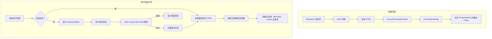

# 受密码保护的文章

恭喜！你已成功解锁这篇加密文章。浏览器使用 **Web Crypto API（AES-256-GCM + PBKDF2）** 在本地解密了预先编译的内容。

---

## 1. 安全架构与核心功能

Shirone 的文章加密系统与受保护相册共享统一的安全基础，为静态发布提供企业级安全保障：

1. **静态 HTML 构建产物中不含明文**\
   在 Astro SSG 构建流程中，文章 Markdown 会先编译为 HTML，再使用 AES-256-GCM 加密后输出页面。发布的静态 HTML 中**不会包含受保护正文或目录的任何明文**。

2. **使用 AAD 范围绑定的认证加密**\
   - 密钥派生遵循 OWASP 建议，使用 **310,000 次 PBKDF2 迭代**（SHA-256）和经过密码学安全随机生成的 16 字节盐值；
   - 每个加密载荷都会生成独立的 12 字节随机 IV；
   - 使用 **附加认证数据（AAD）** 绑定 `shirone-protected-content:1:post:${slug}`，确保密文无法在不同文章或相册之间重放。

3. **会话持久化且不在磁盘存储密码**\
   - 解密后的内容会缓存在浏览器的临时会话存储中，并在 30 分钟后过期；
   - 明文密码绝不会写入磁盘或存储；
   - 同一会话中的解密状态可在 Swup 客户端导航和页面重新加载后无缝保留。

4. **防止全站内容泄露**\
   - **搜索索引**：静态页面不含明文，避免搜索引擎和 Pagefind 为私密内容建立索引；
   - **RSS Feed**：受保护文章在 Feed 中输出本地化占位内容，防止 RSS 聚合器获取敏感文本；
   - **卡片摘要与字数**：设置 `hideHomeContent: true` 后，首页和归档卡片中的摘要与字数都会被隐藏；
   - **目录（TOC）**：解锁前隐藏标题层级；解密后再动态重建目录，并同步应用 M3E 样式。

> 💡 **演示说明**：本文的默认解锁密码为 `shirone-secret`。

---

## 2. 交互式富文本演示

文章解密后，会与运行时辅助程序协同，动态启用语法高亮、代码折叠、交互式 Mermaid 图表、LaTeX 公式和图片灯箱。

### 2.1 代码块与语法高亮

下面的代码块用于测试 Expressive Code 语法高亮、复制操作和行标记：

```typescript
import { decryptProtectedContent, type ProtectedPayload } from "@/utils/password-protection";

/**
 * 客户端文章解密示例
 */
async function unlockArticle(payload: ProtectedPayload, password: string): Promise<string> {
    const scope = payload.scope;
    console.log(`[Shirone] Decrypting scope: ${scope}`);
    
    // 执行 AES-256-GCM 解密并验证 AAD
    const decryptedHtml = await decryptProtectedContent(payload, password, scope);
    console.log("[Shirone] Decryption successful, length:", decryptedHtml.length);
    return decryptedHtml;
}
```

```bash
# 验证构建和类型检查
npx.cmd astro check
pnpm.cmd type-check
pnpm.cmd test
```

### 2.2 Mermaid 架构图

下方流程图通过 Mermaid 渲染，并在解密后动态初始化：



### 2.3 LaTeX 数学公式

行内公式：欧拉恒等式 $e^{i\pi} + 1 = 0$ 和高斯积分 $\int_{-\infty}^{\infty} e^{-x^2} dx = \sqrt{\pi}$。

块级数学公式会放在可水平滚动的容器中：

$$
f(x) = \frac{1}{\sigma \sqrt{2\pi}} \exp\left( -\frac{(x - \mu)^2}{2\sigma^2} \right)
$$

$$
\mathcal{L}_{\text{AES-GCM}} = \text{GHASH}_H(A \parallel C \parallel L) \oplus \text{AES}_K(J_0)
$$

### 2.4 提示容器

:::note 架构说明
此加密系统遵循原子化设计原则和最小化补丁约定，同时确保 SSR 稳定性不受影响。
:::

:::tip 主题集成
解锁后，可以尝试切换亮色与暗色模式，或更改主色调；解密后的组件会动态适配当前设计令牌。
:::

:::important 安全范围
静态客户端加密旨在阻止未授权浏览和自动索引。对于关键商业机密，建议使用服务器端身份验证。
:::

:::warning 密码恢复
静态加密没有集中式服务器数据库。如果忘记密码，加密内容将无法恢复。
:::

### 2.5 GitHub 仓库卡片

::github{repo="withastro/astro"}

---

## 3. 配置参考

| 参数 | 类型 | 必填 | 默认值 | 说明 |
| :--- | :--- | :--- | :--- | :--- |
| `encrypted` | `boolean` | No | `false` | 显式标记文章已加密。设置 `password` 后默认视为 `true`。 |
| `password` | `string` | Yes | None | 用于构建时加密并在运行时解锁的明文密码。 |
| `passwordHint` | `string` | No | `""` | 显示在密码输入框下方的可选提示。 |
| `hideHomeContent` | `boolean` | No | `true` | 在索引卡片、归档和 RSS Feed 中隐藏文章摘要和字数统计。 |

---

## 4. 总结

本演示验证了 Shirone 中完整的加密生命周期：静态输出不含明文、具备可靠的密码学验证能力、会话状态可跨导航和页面重新加载保留，并能在运行时动态重新初始化内容。
