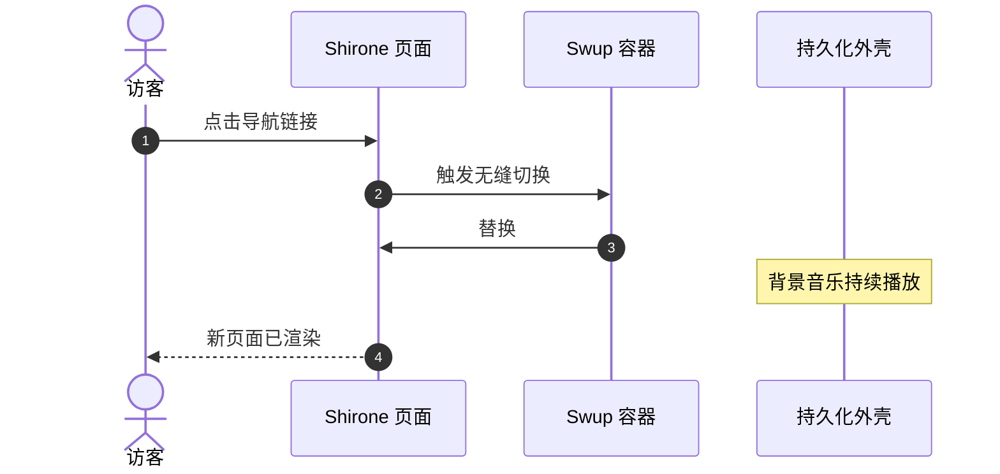

欢迎使用 **Shirone**（白音）——一款以 **Astro 7**、**Svelte 5** 和 **Material 3 Expressive (M3E)** 设计系统为基础打造、富有表现力且受动画风格启发的博客主题。

本指南将介绍文章创建、Frontmatter 规范、目录结构，以及完整的内置 Markdown 和 MDX 扩展。

:::tip
Shirone 优先在服务器端渲染内容（SSR-first）。在站内导航时，Swup 会无缝替换主容器，同时保留外层应用框架和持续播放的音乐。
:::

---

## 1. 创建新文章

使用内置 CLI 命令即可快速生成带有标准 Frontmatter 的新文章骨架：

```bash
# 创建单文件文章
pnpm new-post my-first-post

# 或在子目录中创建文章
pnpm new-post guides/getting-started
```

新文件会放在 `src/content/posts/` 中。

---

## 2. Frontmatter 规范

每篇 Markdown（`.md`）或 MDX（`.mdx`）文章都以 YAML Frontmatter 块开头，用于定义元数据。

### 示例

```yaml
---
title: "探索 Material 3 Expressive 设计"
published: 2026-08-26
updated: 2026-08-27
publishedAt: 2026-08-26T10:00:00+08:00
updatedAt: 2026-08-27T09:30:00+08:00
pinned: true
description: "深入了解 Shirone 中的动态 HCT 色彩科学和流畅过渡效果。"
image: "./cover.webp"
tags: [M3E, 设计, 前端]
category: 指南
draft: false
comment: true
---
```

### 支持的 Frontmatter 字段

| 字段 | 类型 | 必填 | 说明 |
| :--- | :--- | :---: | :--- |
| `title` | `string` | **Yes** | 文章的主标题。 |
| `published` | `Date` | **Yes** | `YYYY-MM-DD` 格式的发布日期。 |
| `publishedAt` | `Date` | No | 用于排列同一天发布的文章的精确发布时间。按配置的站点时区计算后，日期必须与 `published` 相同。 |
| `updated` | `Date` | No | 最后更新日期。填写后会显示更新提示徽标。 |
| `updatedAt` | `Date` | No | Feed 和机器可读元数据使用的精确更新时间。必须与 `updated` 一起填写。 |
| `pinned` | `boolean` | No | 将文章置顶显示在文章列表顶部（默认值：`false`）。 |
| `description` | `string` | No | 显示在文章卡片、搜索结果和 OpenGraph 元数据中的文章摘要。 |
| `image` | `string` | No | 封面图片路径。支持相对路径（`./cover.webp`）、公共路径（`/images/cover.jpg`）或远程 URL。 |
| `tags` | `string[]` | No | 用于分类筛选和标签云的标签名称数组。 |
| `category` | `string` | No | 用于分类索引的主要分类名称。 |
| `draft` | `boolean` | No | 将文章标记为草稿。生产构建时会隐藏草稿文章（`pnpm build`）。 |
| `comment` | `boolean` | No | 为当前文章启用或禁用评论区（默认值：`true`）。 |
| `lang` | `string` | No | 语言代码（如 `en`、`zh_CN`、`ja`），仅在与站点默认语言不同时填写。 |

---

## 3. 文章加密

Shirone 提供客户端文章加密。这是一种静态密码门禁，并非服务器端访问控制：加密载荷和资源 URL 仍可公开下载，因此不要用它保护真正机密的文件或受监管的信息。若要限制日记或文章的访问，请在 Frontmatter 中设置密码：

```yaml
---
title: "私人研究笔记"
published: 2026-08-26
encrypted: true
password: "your-secret-passphrase"
passwordHint: "最喜欢的动画角色"
hideHomeContent: true
---
```

- `encrypted`：设为 `true` 以启用加密；
- `password`：解锁文章所需的密码字符串或数字；
- `passwordHint`：显示在密码输入框上方的可选提示；
- `hideHomeContent`：在首页隐藏字数和内容预览，避免信息泄露。

---

## 4. 组织文章文件

Shirone 同时支持文章与资源共置于文件夹中，以及单文件布局：

### 文件夹结构（推荐用于本地资源）

将文章与媒体文件放在一起，可以简化资源管理：

```text
src/content/posts/
├── my-great-post/
│   ├── index.md           <-- 文章内容
│   ├── cover.webp         <-- 封面图片（image: "./cover.webp"）
│   └── diagram.png        <-- Markdown 中引用的插图
```

### 单文件结构（适用于简短文章）

```text
src/content/posts/
├── hello-world.md
└── quick-thoughts.md
```

---

## 5. 丰富的 Markdown 和 MDX 扩展

Shirone 开箱即用地集成了多种现代 Markdown 扩展：

### 5.1 提示容器

使用容器指令添加说明、提示、警告和提醒：

```markdown
:::tip
使用提示容器突出重点结论或最佳实践。
:::

:::warning
使用警告容器说明潜在问题或不兼容变更。
:::
```

### 5.2 GitHub 仓库卡片

使用指令语法嵌入实时更新、样式精美的 GitHub 仓库卡片：

```markdown
::github{repo="LyraVoid/Shirone"}
```

::github{repo="LyraVoid/Shirone"}

### 5.3 Expressive Code 代码块

增强型代码块支持语法高亮、文件名徽标、行号和指定行高亮：

```typescript title="src/utils/theme.ts" {2,4-5}
// 动态派生 HCT 颜色令牌
import { argbFromHex, themeFromSourceColor } from "@material/material-color-utilities";

const theme = themeFromSourceColor(argbFromHex("#f472b6"));
console.log("主色令牌：", theme.schemes.light.primary);
```

### 5.4 数学公式排版（KaTeX）

直接在 Markdown 中渲染优雅的 LaTeX 数学公式：

- **行内公式**：$E = mc^2$ 或欧拉公式 $e^{i\pi} + 1 = 0$。
- **块级公式**：

$$
\int_{-\infty}^{\infty} e^{-x^2} \, dx = \sqrt{\pi}
$$

### 5.5 Mermaid 图表

使用纯文本创建流程图、时序图和架构图：



### 5.6 图片画廊与 Fancybox 灯箱

图片会自动集成 Fancybox，支持无损缩放、平移手势和全屏预览：

```markdown

```

---

## 6. 后续步骤与自定义

- **站点配置**：在 `src/config/siteConfig.ts` 和 [`src/config/README.md`](https://github.com/LyraVoid/Shirone/blob/main/src/config/README.md) 中了解全局设置。
- **设计令牌**：在 `DESIGN.md` 和 `docs/m3e-standard.md` 中了解设计令牌和配色方案。
- **反馈与社区**：在 [GitHub Issues](https://github.com/LyraVoid/Shirone/issues) 分享想法并提出问题。
