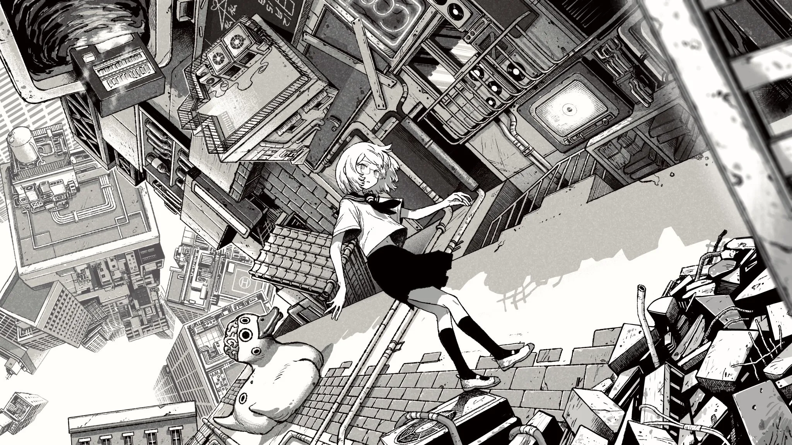
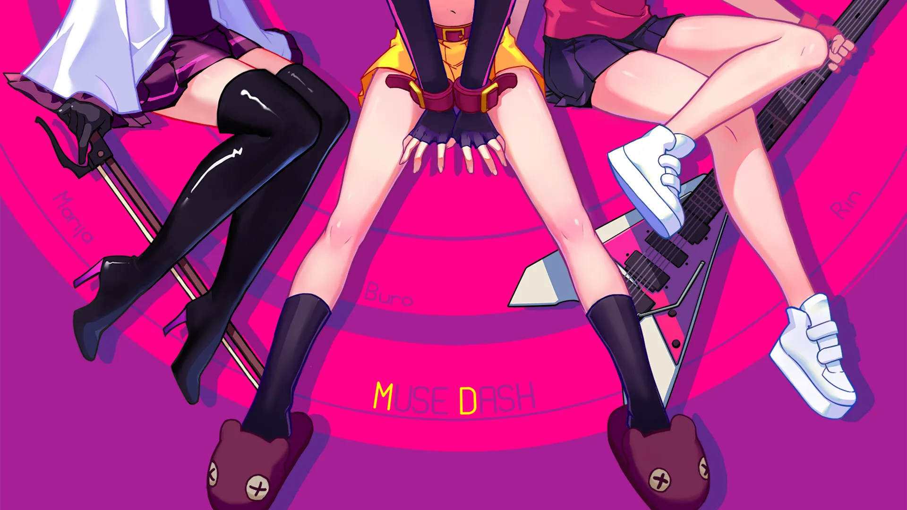
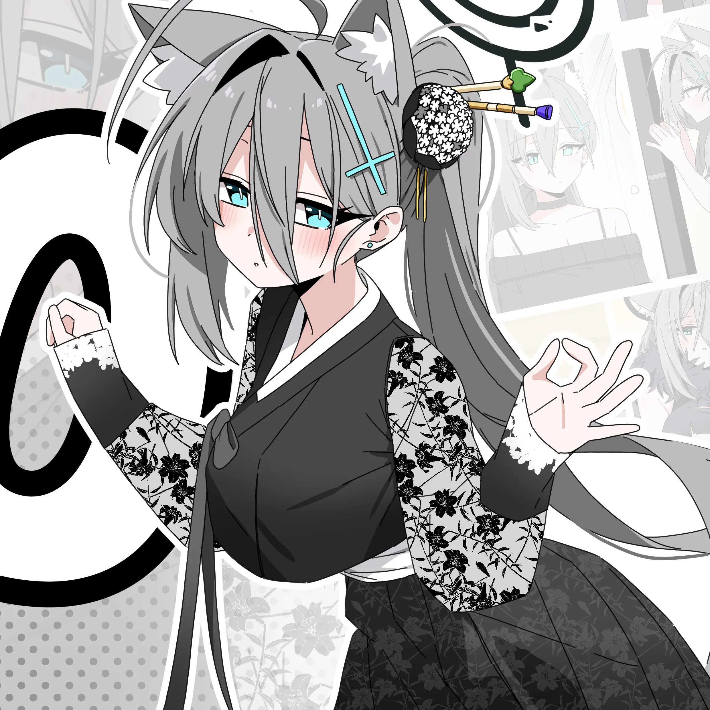
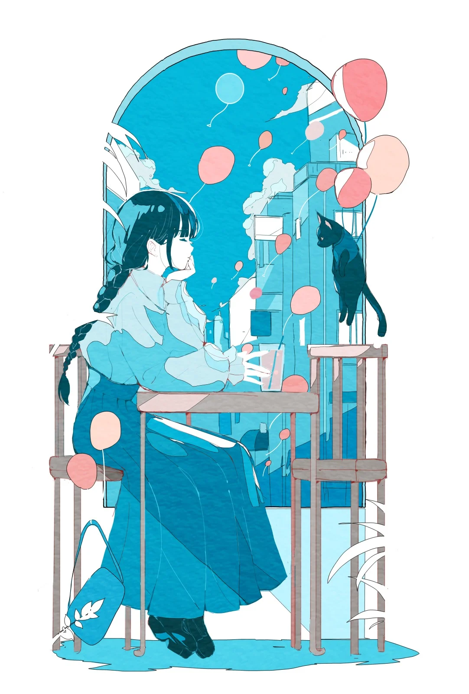
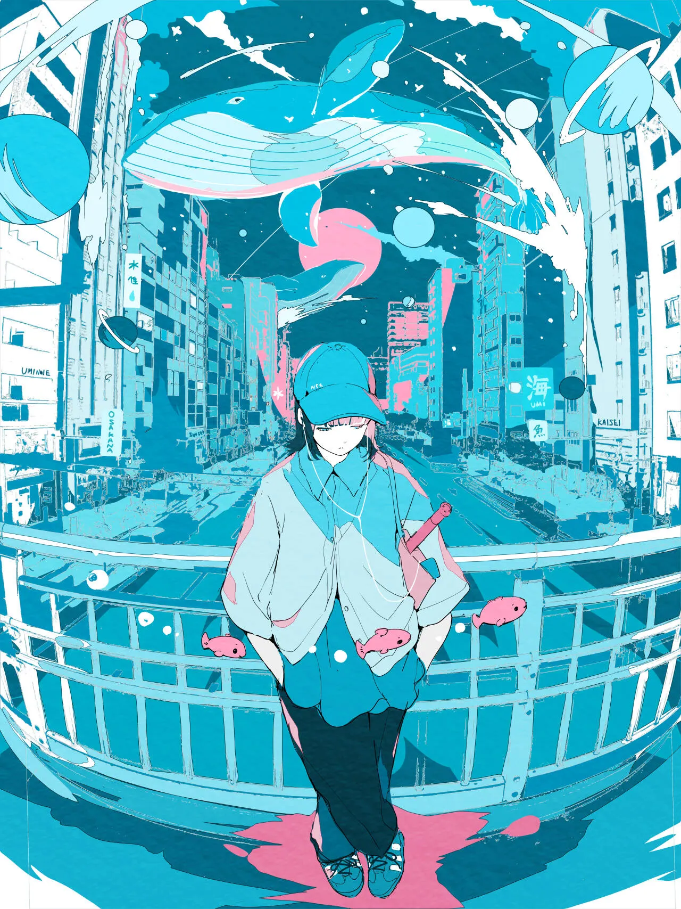
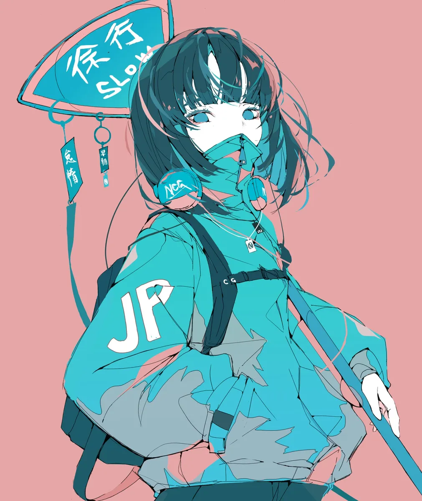
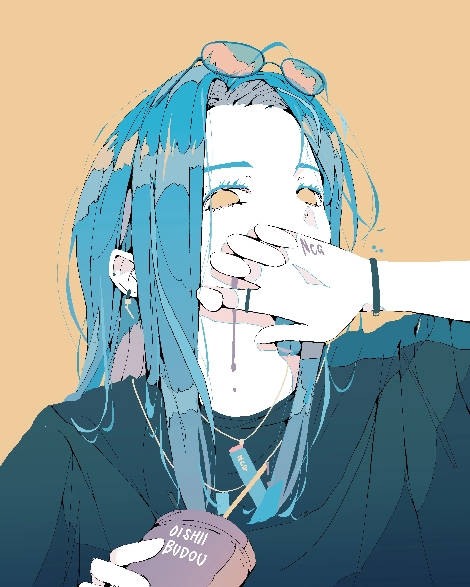
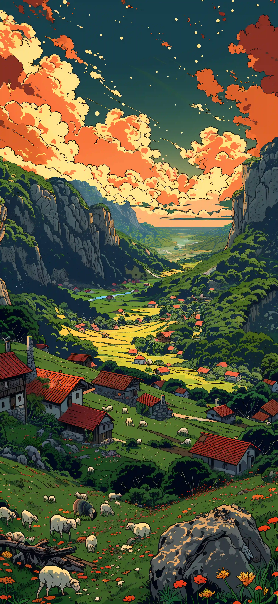
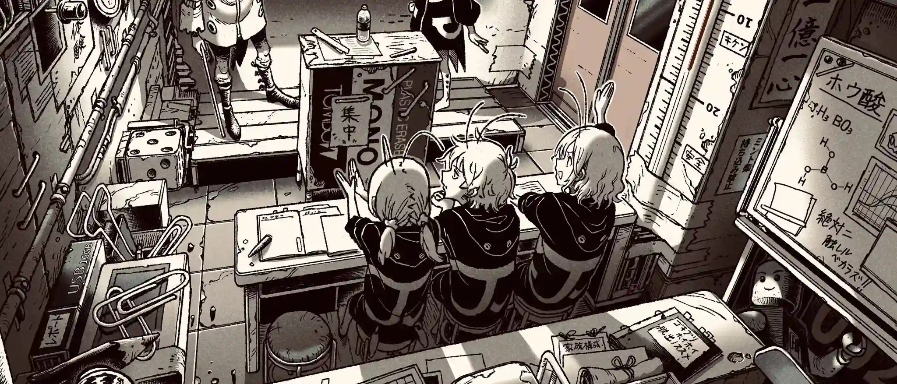

`:::grid` 是博客的图片画廊容器指令。它会将普通 Markdown 图片排列为响应式网格，统一图片比例，并自动启用灯箱查看。可用于文章配图、屏幕截图、作品集或小型相册。

同一画廊中的图片使用相同的卡片比例。默认情况下，图片会从中心裁剪并填满卡片，让每一行保持整齐；点击图片即可在灯箱中查看完整原图。每个画廊都有独立的灯箱分组，不会与文章中的其他图片混在一起。

> 本文既是功能文档，也是视觉测试页面。请分别在桌面、平板和手机宽度下查看示例，再点击图片验证灯箱分组。

## 最简语法

直接在 `:::grid` 和结束标记 `:::` 之间编写 Markdown 图片：

````markdown
:::grid


:::
````

每张图片都必须单独占一个段落，图片之间以空行分隔。画廊中只能放图片；段落、列表和代码块应写在容器之外。

下面是最简语法的渲染结果。不设置参数时，网格默认使用三列、`16/10` 比例和 `cover` 模式。

:::grid



:::

## 参数一览

在起始指令后面的花括号中填写所有参数：`:::grid{parameter="value"}`。

| 参数 | 可用值 | 默认值 | 用途 |
| --- | --- | --- | --- |
| `columns` | Integers from `1` to `6` | `3` | 桌面端每行的列数。无效值会回退为 `3`。 |
| `aspect` | A positive ratio, such as `16/9`, `3/4`, or `1/1` | `16/10` | 卡片的显示比例，而非原图比例。 |
| `fit` | `cover`, `contain` | `cover` | 图片适配模式。`cover` 会裁剪并填满卡片；`contain` 会保留完整图片，但可能出现留白。 |

完整示例：

````markdown
:::grid{columns="3" aspect="16/9" fit="cover"}


:::
````

以下结果使用了上方的三列横图语法。请比较卡片比例、列数，以及标题优先于 alt 文本成为说明文字的效果：

:::grid{columns="3" aspect="16/9" fit="cover"}



:::

## 说明文字与 Alt 文本

图片的 alt 文本既是无障碍替代文本，也是默认说明文字。如果图片设置了可选标题，则会优先使用该标题作为说明文字：

```markdown

```

同一行中的说明文字会在每张卡片底部对齐。即使某条说明换行，也不会导致其他说明的高度错位。`3:4` 和 `16:9` 这样的比例可以直接写在正文、标题和 alt 文本中，无需转义。

此示例展示默认使用 alt 文本作为说明、显式设置标题说明，以及较长说明文字的底部对齐效果：

:::grid{columns="3" aspect="1/1"}





:::

## 布局与裁剪

桌面布局使用 `columns` 指定的列数。视口宽度低于 `768px` 时，网格最多显示两列；低于 `480px` 时则切换为单列。卡片容器会固定 `aspect` 比例并裁切圆角；图片则填满卡片，不受主题默认图片边距影响。

- 选择 `cover`：推荐的默认模式。图片会从中心裁剪并填满卡片，让整个画廊保持一致。
- 选择 `contain`：显示完整原图，不进行裁剪。如果原图比例与卡片不同，则会露出主题背景；适用于不能裁剪的图片。
- 如果希望完整显示图片且不留空白，可以将 `aspect` 设置为接近原图的比例，或将图片单独放在一个网格中。

以下示例将相同的竖图放入 `16/9` 卡片，分别使用 `cover` 和 `contain`。前者会裁剪图片，后者保留完整图片并留出背景区域。

````markdown
:::grid{columns="3" aspect="16/9" fit="cover"}


:::

:::grid{columns="3" aspect="16/9" fit="contain"}


:::
````

:::grid{columns="3" aspect="16/9" fit="cover"}




:::

:::grid{columns="3" aspect="16/9" fit="contain"}


:::

## 默认配置

不设置属性时，默认使用三列、`16/10` 比例和 `cover` 裁剪。以下三张竖图用于验证默认裁剪和说明文字。

````markdown
:::grid


:::
````

:::grid


:::

## 三列竖图：3:4

设置 `aspect="3/4"` 后，三张竖图会填充比例统一的纵向卡片。如果原图比例不同，`cover` 会从中心向边缘裁剪。

````markdown
:::grid{columns="3" aspect="3/4"}



:::
````

:::grid{columns="3" aspect="3/4"}


:::

## 三列横图：16:9

这组示例在三列布局中展示常见的视频封面比例。当横图比例接近卡片比例时，裁剪会很少。

````markdown
:::grid{columns="3" aspect="16/9"}


:::
````

:::grid{columns="3" aspect="16/9"}


:::

## 两列方图：1:1

需要较大的预览卡片时，两列布局十分合适。第三张图片会移至下一行，最后一行保持网格轨道宽度，不会拉伸图片以填满整行。

````markdown
:::grid{columns="2" aspect="1/1"}


:::
````

:::grid{columns="2" aspect="1/1"}


:::

## 使用 `contain` 的四列布局

`fit="contain"` 不会裁剪原图。当图片比例与卡片比例不同时，会露出主题背景。这是预期效果，并非布局问题。此示例还用于验证四列网格和独立灯箱分组互不干扰。

````markdown
:::grid{columns="4" aspect="16/9" fit="contain"}


:::
````

:::grid{columns="4" aspect="16/9" fit="contain"}


:::

## 单列细节图片

图片需要更大的阅读尺寸时，适合使用单列布局。在桌面、平板和手机上都会保持单列，灯箱中仍可查看原图。

````markdown
:::grid{columns="1" aspect="16/9"}

:::
````

:::grid{columns="1" aspect="16/9"}

:::

## 稀疏五列布局

五列布局用于验证较高的列数。只有三张图片时，最后一行会保持左对齐，而不会拉伸图片。

````markdown
:::grid{columns="5" aspect="1/1"}


:::
````

:::grid{columns="5" aspect="1/1"}


:::

## 六列混合图片

六列是当前支持的最大列数。混排横图和竖图，可以验证 `cover` 裁剪、窄卡片中的说明文字，以及桌面端的紧凑布局。为了保证文章易读，通常建议使用两到四列。

````markdown
:::grid{columns="6" aspect="1/1"}


:::
````

:::grid{columns="6" aspect="1/1"}


:::

## 四列方图：1:1

四张比例相同的方图适合典型的四列布局。桌面端会将四张图片排列在一行；平板端折叠为两列，手机端则为一列。

````markdown
:::grid{columns="4" aspect="1/1"}


:::
````

:::grid{columns="4" aspect="1/1"}


:::

## 六列横图：16:9

六列横图适合缩略图预览、作品集和屏幕截图索引。即使原图比例略有不同，`cover` 也能一致地填满每个 `16/9` 卡片。

````markdown
:::grid{columns="6" aspect="16/9"}


:::
````

:::grid{columns="6" aspect="16/9"}


:::

## 三列竖图：3:4

这组六张竖图展示人物图片、海报或手机截图的常见布局。图片分为两行、每行三张，说明文字在卡片底部对齐。

````markdown
:::grid{columns="3" aspect="3/4"}





:::
````

:::grid{columns="3" aspect="3/4"}


:::

## 边缘关键内容：`cover` 与灯箱

这些图片的边缘处包含重要文字或细节。`cover` 可以让网格保持整齐，但可能裁掉边缘；点击图片即可在灯箱中查看未裁剪的原图。边缘细节重要时，请使用清晰的说明文字，或改用下方的 `contain` 模式。

````markdown
:::grid{columns="3" aspect="16/9" fit="cover"}


:::
````

:::grid{columns="3" aspect="16/9" fit="cover"}


:::

## 使用 `contain` 处理极端比例

对于横幅、长屏幕截图和其他比例极端的图片，`contain` 可以完整显示原图。与 `cover` 不同，它可能会露出主题背景，但不会裁剪图片内容。

````markdown
:::grid{columns="3" aspect="16/9" fit="contain"}


:::
````

:::grid{columns="3" aspect="16/9" fit="contain"}





:::

## 透明图片

透明图片可以透出卡片的主题背景。此单列 `contain` 示例便于查看透明区域、原图边缘和灯箱效果。

````markdown
:::grid{columns="1" aspect="16/9" fit="contain"}

:::
````

:::grid{columns="1" aspect="16/9" fit="contain"}

:::

## 灯箱导航

点击网格中的任意图片即可打开 Fancybox 灯箱。在灯箱中，你可以缩放、旋转、进入全屏、查看缩略图，或使用方向键切换图片。导航范围仅限于当前 `:::grid` 容器：例如，点击“16:9 测试图片一”只会显示该分组中的另外两张横图。

同一篇文章中的普通 Markdown 图片仍会单独处理，不会加入任何网格画廊。

## 检查清单

1. 每个网格中的图片尺寸一致，说明文字显示在卡片下方。
2. 鼠标悬停时图片会轻微放大；点击后可以缩放、旋转，也可以使用键盘切换。
3. 点击“16:9 测试图片一”后，灯箱只能浏览该分组中的另外两张横图。
4. 视口宽度低于 768px 时，网格最多显示两列；低于 480px 时改为单列。
5. “使用 `contain` 的四列布局”中的竖图应完整显示，留有空白且不会被裁剪。
6. 五列和六列网格在宽屏上保持指定列数，再根据响应式规则折叠为两列或一列。
