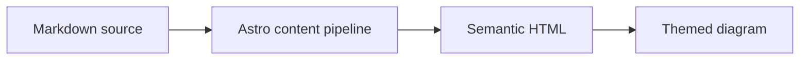

## GitHub 仓库卡片
你可以添加指向 GitHub 仓库的动态卡片。页面加载时，系统会从 GitHub API 获取仓库信息。

::github{repo="Fabrizz/MMM-OnSpotify"}

使用 `::github{repo="<owner>/<repo>"}` 创建 GitHub 仓库卡片。

```markdown
::github{repo="saicaca/fuwari"}
```

## Mermaid 图表

围栏代码块中的 `mermaid` 内容会渲染为图表，并跟随当前配色方案。



## 提示容器

支持以下类型的提示容器：`note`、`tip`、`important`、`warning` 和 `caution`。

:::note
突出显示即使快速浏览时也值得注意的信息。
:::

:::tip
帮助读者更顺利完成任务的可选信息。
:::

:::important
读者成功完成任务所必需的重要信息。
:::

:::warning
因潜在风险而需要读者立即注意的关键信息。
:::

:::caution
说明某项操作可能造成的不良后果。
:::

### 基本语法

```markdown
:::note
突出显示即使快速浏览时也值得注意的信息。
:::

:::tip
帮助读者更顺利完成任务的可选信息。
:::
```

### 自定义标题

提示容器的标题可以自定义。

:::note[我的自定义标题]
这是一个带有自定义标题的说明容器。
:::

```markdown
:::note[我的自定义标题]
这是一个带有自定义标题的说明容器。
:::
```

### GitHub 语法

> [!TIP]
> 同样支持 [GitHub 语法](https://github.com/orgs/community/discussions/16925)。

```
> [!NOTE]
> 同样支持 GitHub 语法。

> [!TIP]
> 同样支持 GitHub 语法。
```

### 剧透内容

你可以在文本中添加剧透内容。剧透文本也支持 **Markdown** 语法。

内容 :spoiler[已隐藏 **啦**]！

```markdown
内容 :spoiler[已隐藏 **啦**]！

```

## 图片宽度与说明文字

独立图片的 alt 文本中可以包含可选的 `w-N%` 宽度标记；Markdown 标题则会显示为图片下方居中的说明文字：


```markdown

```

有效宽度范围为 `w-1%` 至 `w-100%`；无效标记会保留在 alt 文本中。宽度和说明文字相互独立——仅填写标题也会显示说明文字：


