Mermaid 可以将 Markdown 中的文本描述转换为图表。以下示例使用 Shirone 的内容工作流，展示技术文章和项目笔记中常见的图表类型。

## 流程图

流程图用于描述一个流程，包括决策分支以及返回前序步骤的路径。

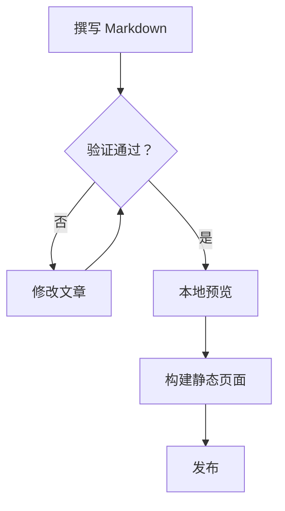

## 时序图

时序图按照时间顺序展示参与者之间的交互。此示例展示一次 Swup 导航从发起请求到渲染 Mermaid 图表的过程。

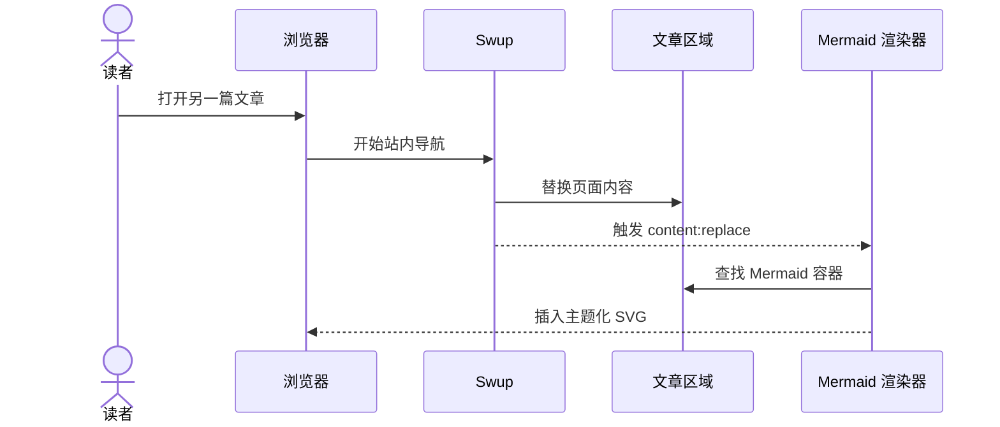

## 实体关系图

实体关系图用于描述结构化数据及其关系，例如作者、文章、标签和评论之间的联系。

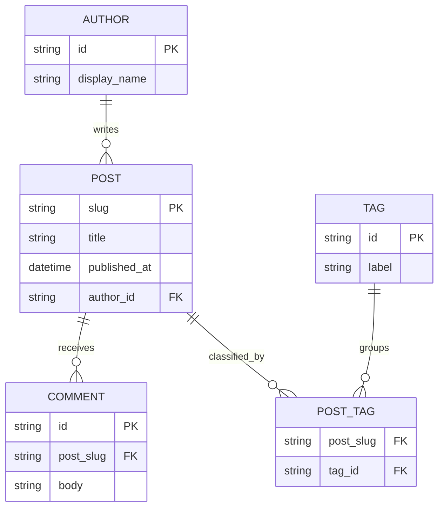

## 类图

类图用于展示软件设计中的职责、公共方法和依赖方向。

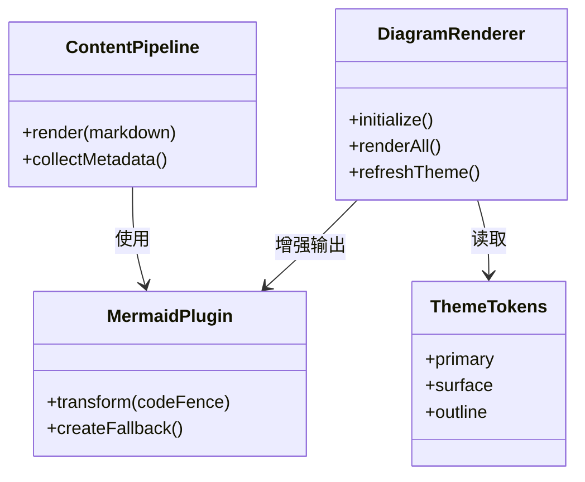

## 状态图

状态图展示对象的生命周期，以及使其在不同状态间转换的事件。

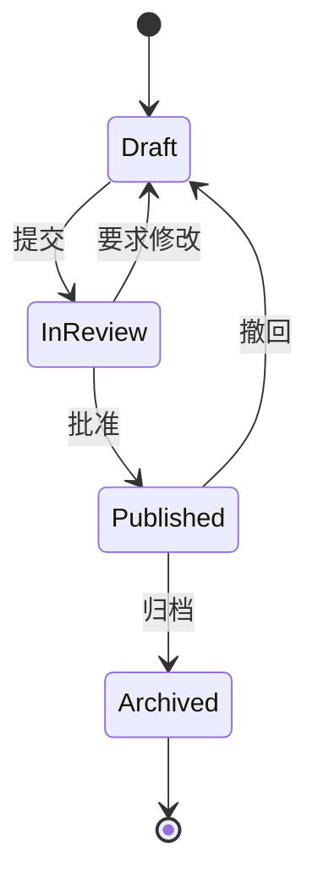

## XY 图表

XY 图表将柱状图和折线图组合在一起，用于比较共享坐标轴上的数值和趋势。

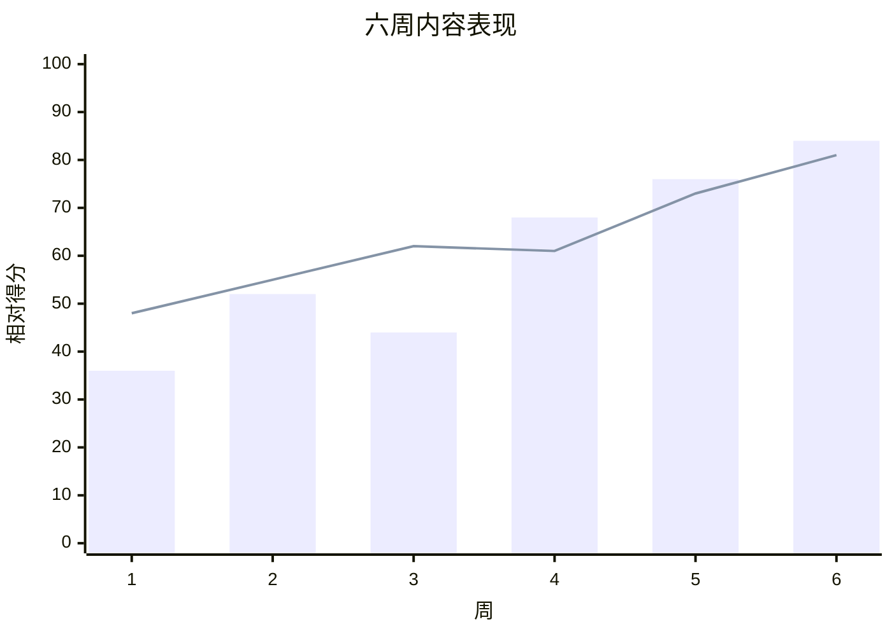

## 饼图

饼图可以直观比较各类别在整体中所占的比例。

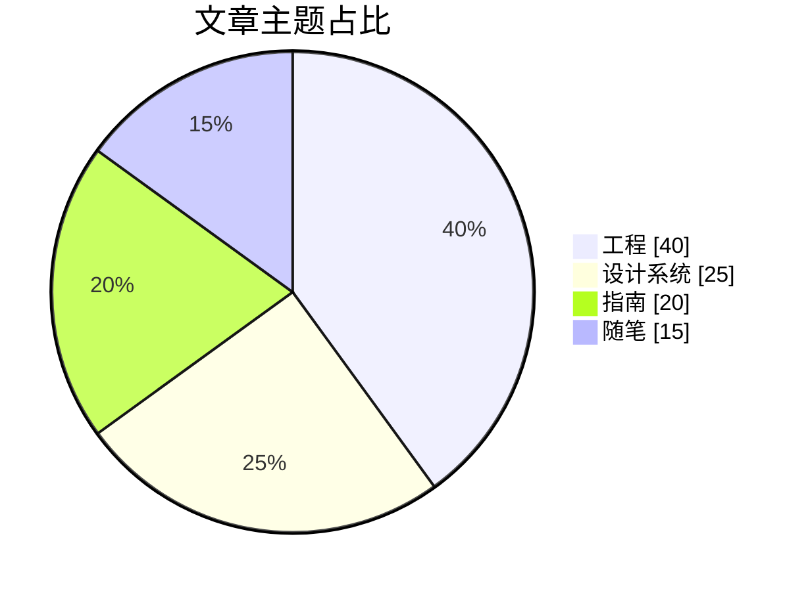

## 甘特图

甘特图沿日历时间轴排列任务、依赖关系和里程碑。

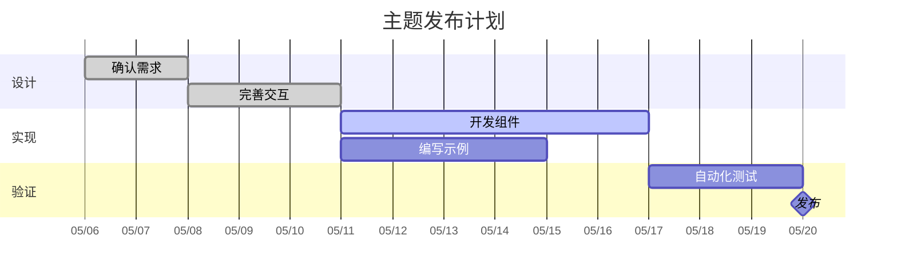

## 思维导图

思维导图以一个中心主题为起点，展开相关领域和支撑概念。

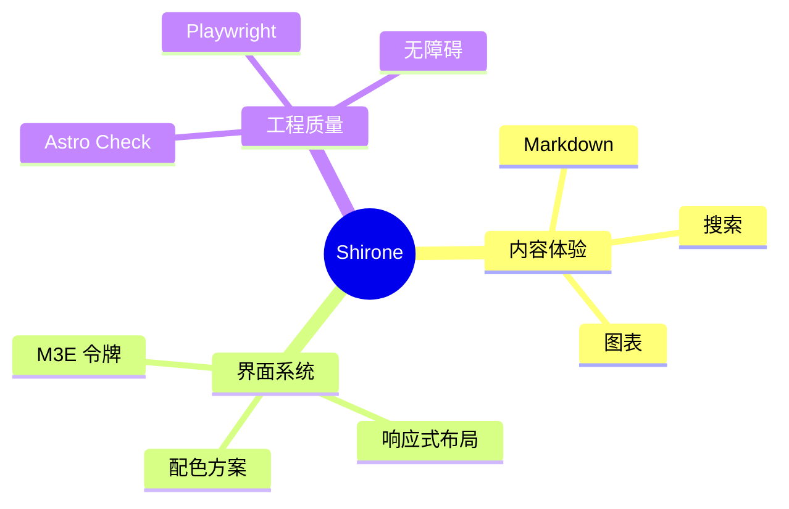

## 时间线

时间线可以概括重要事件或阶段，无需提供精确的日历时长。

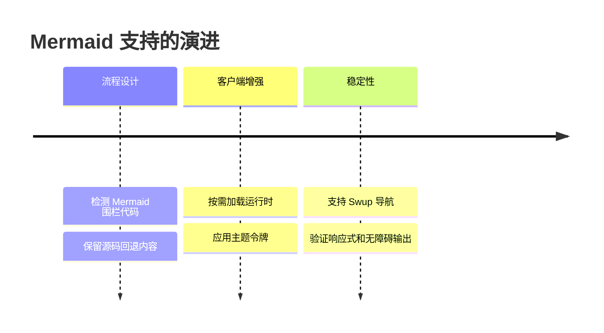

## 用户旅程

用户旅程图展示任务各阶段中的操作、参与者和体验评分。

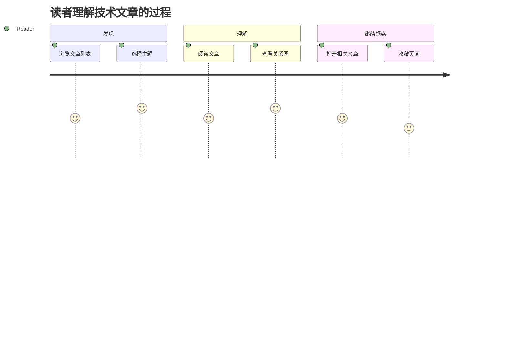

## Git 提交图

Git 提交图展示功能分支上的工作进展，以及它最终如何合并回主分支。

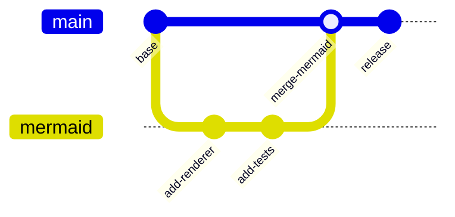

## 看板

看板按照工作流状态对任务分组，方便快速查看当前进度。

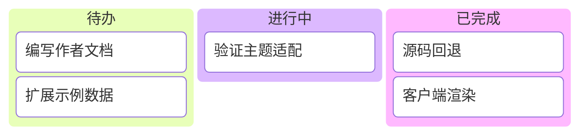

## 桑基图

桑基图通过连线宽度表示流量或其他数值在不同节点之间的流动情况。

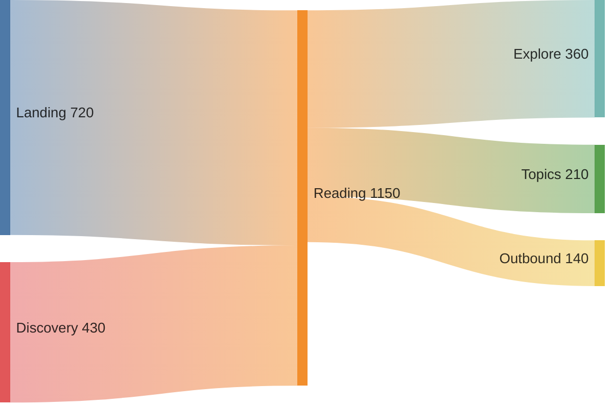

每个示例都使用标准的 `mermaid` 围栏代码。服务器会保留可读的源标记，浏览器则将其增强为符合当前主题的 SVG。切换主题或通过 Swup 导航至本文时，图表都会重新渲染。