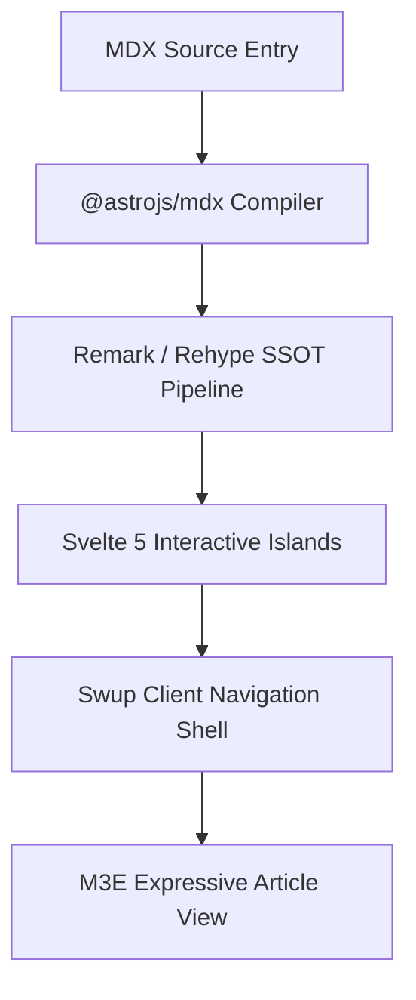

import Button from "@components/atoms/action/Button.svelte";
import Chips from "@components/atoms/action/Chips.svelte";
import Card from "@components/atoms/display/Card.svelte";
import AccentBar from "@components/atoms/display/AccentBar.svelte";
import Badge from "@components/atoms/display/Badge.svelte";
import Divider from "@components/atoms/display/Divider.svelte";
import Skeleton from "@components/atoms/display/Skeleton.svelte";
import LoadingIndicator from "@components/atoms/feedback/LoadingIndicator.svelte";
import ProgressIndicator from "@components/atoms/feedback/ProgressIndicator.svelte";
import TextField from "@components/atoms/input/TextField.svelte";
import Switch from "@components/atoms/selection/Switch.svelte";
import Checkbox from "@components/atoms/selection/Checkbox.svelte";
import SegmentedButton from "@components/atoms/selection/SegmentedButton.svelte";
import Slider from "@components/atoms/selection/Slider.svelte";

export const authorInfo = {
  framework: "Astro 7",
  ui: "Svelte 5",
  tokens: "M3E Design Tokens",
  architecture: "Islands Architecture"
};

export const showcaseItems = [
  { name: "原子组件嵌入", desc: "可直接在文章内容中导入并渲染 60 多个 M3E 原子组件和分子组件" },
  { name: "Svelte 5 交互岛屿", desc: "通过 client:visible 选择性地进行 hydration，避免不必要的 JavaScript 开销" },
  { name: "JSX 表达式", desc: "使用原生 JavaScript 变量、数据映射和条件渲染" },
  { name: "扩展处理流程", desc: "通过统一的 SSOT 编译处理 Mermaid、KaTeX、提示容器和 Expressive Code" }
];

export const filterChipOptions = [
  { value: "all", label: "所有组件" },
  { value: "display", label: "展示原子组件" },
  { value: "feedback", label: "反馈" },
  { value: "action", label: "交互组件" }
];

export const segmentedOptions = [
  { value: "linear", label: "线性" },
  { value: "circular", label: "圆形" },
  { value: "morph", label: "变形" }
];

:::tip
**MDX（Markdown + JSX）**连接了静态写作与应用界面。在 Shirone 中，作者可以直接在文章内容中无缝组合动态逻辑、响应式 Svelte 5 组件和 Material 3 设计令牌。
:::

## 1. Markdown 与 MDX 功能对比

| 功能 | 标准 Markdown（`.md`） | Shirone MDX（`.mdx`） | 执行模式 |
| :--- | :--- | :--- | :--- |
| **排版与结构** | 完整支持 | 完整支持 | 静态 SSR |
| **代码高亮** | 行号、框架、可折叠 | 行号、框架、可折叠 | 静态 SSR（Expressive Code） |
| **图表与数学公式** | Mermaid、KaTeX | Mermaid、KaTeX | 客户端增强 |
| **提示容器** | 说明、提示、重要、警告、注意 | 说明、提示、重要、警告、注意 | 静态 SSR |
| **M3E 展示原子组件** | 不支持 | 直接集成（`<Card>`、`<Skeleton>`） | 纯 SSR（无客户端 JS） |
| **Svelte 5 响应式岛屿** | 不支持 | 按需 hydration（`<Button>`、`<Switch>`） | 使用 `client:visible` 延迟 hydration |
| **反馈与加载原子组件** | 不支持 | 动态变形（`<LoadingIndicator>`） | `client:visible` 响应式 |
| **动态 JSX 表达式** | 不支持 | 原生求值（`{authorInfo.ui}`） | 编译时／客户端 |

---

## 2. 动态表达式与数据映射

MDX 支持在文件顶部使用 `export const` 声明作用域内常量，并在正文中直接求值或映射到模板中：

- **Core Framework**: {authorInfo.framework}
- **UI Engine**: {authorInfo.ui}
- **Design Tokens**: {authorInfo.tokens}
- **Architecture Pattern**: {authorInfo.architecture}

数组和集合也可以动态渲染为网格布局：

  {showcaseItems.map((item, idx) => (
    

      

        
          {idx + 1}
        
        {item.name}
      

      
{item.desc}

    

  ))}

---

## 3. M3E Display and Layout Primitives (SSR-Only)

根据 Shirone 的组件架构（`docs/atomic-structure.md`），无状态展示组件会输出简洁、易访问的语义化 HTML，且不会附带客户端运行时负载。

### 3.1 卡片容器（`Card.svelte`）

  <Card variant="filled" class="!p-5">
    
填充卡片

    
使用默认容器背景，不带阴影。适合组合展示内容块。

  </Card>

  <Card variant="elevated" class="!p-5">
    
浮起卡片

    
使用第 1 层容器高度，并通过交互状态叠层增强视觉焦点。

  </Card>

  <Card variant="outlined" class="!p-5">
    
描边卡片

    
清晰的 1px 描边可在中性色表面上形成明确分隔。

  </Card>

### 3.2 强调条与徽标（`AccentBar` 和 `Badge`）

  <AccentBar size="large" />
  

    系统公告
    
组合使用 AccentBar 和 Badge，构建醒目的视觉提示

  

  <Badge>M3E v0.192</Badge>

### 3.3 骨架屏占位符（`Skeleton.svelte`）

用于预览布局骨架或模拟异步状态：

  

    <Skeleton variant="circle" width="2.5rem" height="2.5rem" />
    

      <Skeleton variant="text" width="40%" height="0.875rem" />
      <Skeleton variant="text" width="25%" height="0.75rem" />
    

  

  <Skeleton variant="rect" width="100%" height="3rem" radius="0.5rem" />

---

## 4. 反馈与加载指示器

Shirone 提供完整实现 Material 3 Expressive 动效规范的反馈原子组件：

### 4.1 变形加载指示器（`LoadingIndicator.svelte`）

该组件使用 `androidx.graphics.shapes` 实现多边形变形，提供流畅的弹簧插值七形态动画：

  

    

      <LoadingIndicator client:visible />
    

    不确定进度形态变换
  

  

    

      <LoadingIndicator client:visible contained />
    

    容器内圆形变体
  

  

    

      <LoadingIndicator client:visible progress={0.68} />
    

    确定进度（68%）
  

### 4.2 线性与不确定进度（`ProgressIndicator.svelte`）

  

    

      流程编译
      80%
    

    <ProgressIndicator client:visible progress={0.8} />
  

  

    
连续双线动画

    <ProgressIndicator client:visible />
  

---

## 5. 交互式 Svelte 5 岛屿

声明为 `client:visible` 的组件会在进入视口时通过 `IntersectionObserver` 延迟 hydration：

### 5.1 按钮矩阵（`Button.svelte`）

  <Button client:visible variant="filled">填充按钮</Button>
  <Button client:visible variant="elevated">浮起按钮</Button>
  <Button client:visible variant="tonal">柔和按钮</Button>
  <Button client:visible variant="outlined">描边按钮</Button>
  <Button client:visible variant="text">文本按钮</Button>

### 5.2 筛选芯片与分段按钮（`Chips` 和 `SegmentedButton`）

  

    
M3E 筛选芯片

    <Chips client:visible items={filterChipOptions} value="all" />
  

  <Divider />

  

    
分段控件

    <SegmentedButton client:visible options={segmentedOptions} value="linear" />
  

### 5.3 开关、复选框与滑块（`Switch`、`Checkbox`、`Slider`）

  

    带状态图标的开关
    <Switch client:visible checked={true} icons label="推送通知" />
  

  <Divider />

  

    复选框
    

      <Checkbox client:visible checked={true} label="已选中" />
      <Checkbox client:visible checked={false} label="未选中" />
      <Checkbox client:visible checked={null} triState label="未确定" />
    

  

  <Divider />

  

    色相光谱滑块
    <Slider client:visible value={60} label="调整色相" />
  

### 5.4 输入控件（`TextField.svelte`）

  <TextField client:visible variant="filled" label="填充文本框" placeholder="输入文本……" />
  <TextField client:visible variant="outlined" label="描边文本框" placeholder="输入文本……" />

---

## 6. Markdown 扩展兼容性

Shirone 的 SSOT unified 插件处理流程与所有 Markdown 扩展保持完整兼容：

### 6.1 GitHub 仓库卡片

::github{repo="saicaca/fuwari"}

### 6.2 Mermaid 架构图

### 6.3 数学表达式（LaTeX / KaTeX）

行内公式：质能等价关系 $E = mc^2$ 和高斯积分 $\int_{-\infty}^{\infty} e^{-x^2} dx = \sqrt{\pi}$。

块级公式：

$$
\mathcal{L}_{M3E} = \sum_{i=1}^{N} \left( \text{Token}_i \cdot \text{ContrastRatio} \right) + \lambda \|\text{MotionElegance}\|
$$

---

## 7. 总结

MDX 的原生集成让技术作者能够构建丰富的交互式文档，同时保留 Shirone 极快的静态性能。所有组件都遵循 Material 3 Expressive 设计令牌体系，确保一致性、无障碍性和视觉协调。
